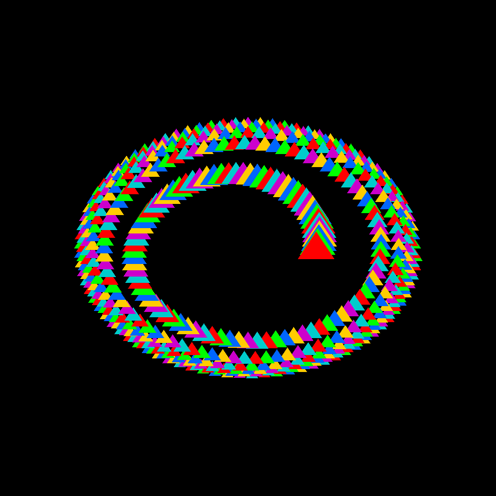

# simple ISPC rasterization benchmark

A simple rasterization benchmark written with Intel ISPC.

## Tested environment

- Windows
- AMD Ryzen 7 9850X3D 8-Core Processor
- MSVC 19.44.35225.0 (VS2022)
- ISPC v1.30.0
- AVX2

## Benchmark results

| Test / stage | C++ multi-threaded (scalar) | ISPC (AVX2) | Speedup |
| --- | --- | --- | --- |
| **Buffer fill (640×480)** | | | |
| total | 1.78 ms | 0.12 ms | 15.0× |
| **Triangle rasterization (1024×1024, 512 triangles)** | | | |
| get_pixel_count | 0.02 ms | 0.03 ms | 0.8× |
| rasterize | 4.22 ms | 1.01 ms | 4.2× |
| shading | 0.39 ms | 0.33 ms | 1.2× |
| total | 4.68 ms | 1.36 ms | 3.4× |
| **Tiled shading (1024×1024, 512 triangles)** | | | |
| get_tile_triangle_count | 0.03 ms | 0.03 ms | 0.8× |
| build_tile_data | 0.01 ms | 0.01 ms | 0.8× |
| tile_shading | 6.73 ms | 6.13 ms | 1.1× |
| total | 6.77 ms | 6.18 ms | 1.1× |



*Test scene: 512 triangles along a spiral, rendered at 1024×1024.*

## Build

### CMake GUI

1. Open the CMake GUI, click Configure, and set the ISPC compiler path (`ISPC_EXECUTABLE`), `ISPC_ISA`, and `ISPC_TARGET_ARCH`.
2. Click Generate, then open the generated solution in Visual Studio and build it.

### Command line

```bash
cmake -S . -B build -DISPC_EXECUTABLE="C:/path/to/ispc.exe" -DISPC_ISA=avx2 -DISPC_TARGET_ARCH=x86-64
cmake --build build --config Release
```
